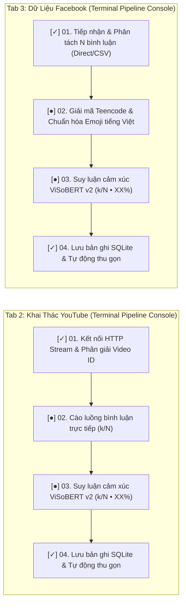

# Kế Hoạch Triển Khai: Tinh Gọn Văn Bản Frontend & Bổ Sung Live Terminal Pipeline Console (YouTube & Facebook)

> **Design Read (`/design-taste-frontend`)**: Reading this as an **AI Social Sentiment Observatory Workbench** for **NLP/Data Analysts**, with a **Deep Obsidian & Precision Terminal Telemetry** language (`DESIGN_VARIANCE: 7`, `MOTION_INTENSITY: 6`, `VISUAL_DENSITY: 5`).

---

## 1. Kiến Trúc Luồng Thực Thi & Thanh Tiến Trình (Mermaid)

---

## 2. Chi Tiết Tinh Gọn Văn Bản & Khung Giao Diện (Theo Lựa Chọn Trên Canvas)

### 2.1. Thanh Thương Hiệu Đỉnh Trang (`frontend/components/navbar.py`)
- **Giữ lại**: Biểu tượng tia chớp SVG và tiêu đề chính **`ViSoBERT Studio`**.
- **Xoá bỏ**:
  - Phụ đề `Neural Social Intelligence Observatory`.
  - Toàn bộ cụm 4 chip telemetry góc phải (`ONLINE`, `Thiet bi: CUDA GPU`, `Mo hinh: ViSoBERT v2`, `CSDL: ... bai | ... cmt`).

### 2.2. Tab 1 — Tổng Quan & Phân Tích (`overview_view.py`, `cards.py`, `charts.py`)
- **Thanh chọn tập dữ liệu (`overview_view.py:L23`)**:
  - Rút gọn chuỗi hiển thị của mỗi bản ghi trong `selectbox` (bỏ phần hiển thị đường dẫn URL dài `https://www.youtube.com/...`, chỉ hiển thị gọn: `Bản ghi #12 • [YouTube] (50 bình luận)`).
- **Khối Cockpit Cảm Xúc (`cards.py`)**:
  - **Cánh Trái**: Xoá hàng thông số phụ dưới đáy (`Độ bất định (Entropy)`, `Độ lệch thuần`, `Kênh dữ liệu`).
  - **Cánh Phải**: Xoá nhãn phụ `ViSoBERT v2 Classification` ở góc trên bên phải.
- **2 Biểu Đồ Trực Quan (`charts.py`)**:
  - **Biểu đồ tròn Donut**: Xoá dòng caption `Tỷ lệ % của 4 nhóm phân lớp cảm xúc trên tập mẫu N = ... ý kiến`.
  - **Biểu đồ cột Histogram**: Xoá dòng caption `Khảo sát mức độ phân cực ý kiến theo 5 phân khoảng chuẩn hóa`.
- **Khối 3 Thẻ Spotlight (`cards.py`)**:
  - Xoá thông số góc phải dưới chân 3 thẻ (`Xác suất +: ...%`, `Xác suất -: ...%`, `Vừa khen vừa chê`), chỉ giữ lại thông tin `Tác giả` gọn gàng.
- **Bảng Duyệt & Tra Cứu Bình Luận (`overview_view.py`)**:
  - Xoá badge `DATA_EXPLORER` ở góc phải tiêu đề bảng.
  - Xoá dòng caption `Đang hiển thị X trên tổng số Y bình luận phù hợp tiêu chí tra cứu.`.
- **Cửa Sổ Minh Bạch Truy Vấn SQL (`overview_view.py:L178-L213`)**:
  - **Xoá toàn bộ khối `st.expander("Cửa Sổ Minh Bạch Truy Vấn SQL Quan Hệ...")`** (bao gồm tiêu đề, đoạn mô tả, đoạn code SQL mẫu và bảng tổng thể bên trong).

### 2.3. Tab 2 — Khai Thác YouTube (`frontend/views/youtube_view.py`)
- **Cột Trái (`Trạm Khai Thác Bình Luận YouTube`)**:
  - Xoá badge `YOUTUBE_CRAWLER` ở góc phải tiêu đề.
  - Xoá hoàn toàn cụm `st.pills("Video thử nghiệm nhanh:", ...)` cùng 2 lựa chọn (`Review Công Nghệ (tpOkBUamk6M)`, `Bản Tin Xã Hội (etcYBI7L1D8)`) và hàm callback đi kèm.
  - Trong thẻ Preview Video: Xoá dòng chữ `● Sẵn sàng kết nối` (chỉ giữ lại `ID: {video_id}` và đường dẫn rút gọn).
- **Cột Phải**:
  - **Xoá hoàn toàn khung Card 1: `Cơ Chế Scraper YouTube Tự Động` (`HEADLESS_STREAM`)** cùng toàn bộ 3 gạch đầu dòng giải thích bên trong, giúp khung `Video YouTube Đã Phân Tích` đẩy lên trên đầu cột phải cân đối với cột trái.

### 2.4. Tab 3 — Dữ Liệu Facebook (`frontend/views/facebook_view.py`)
- **Cột Trái (`Trạm Nhập Liệu Bình Luận Facebook`)**:
  - Xoá hoàn toàn cụm `st.pills("Gợi ý nhãn nhanh:", ...)` cùng 4 lựa chọn (`Feedback Khách Hàng`, `Chiến Dịch Truyền Thông`, `Trải Nghiệm Dịch Vụ`, `Review Sản Phẩm`) và callback đi kèm.
  - Ở dòng trạng thái bên dưới ô nhập bình luận: Giữ lại `Phát hiện: X bình luận`, **xoá bỏ** dấu `•` và cụm `Chuẩn hóa: Tự động làm sạch & map token`.
- **Cột Phải**:
  - **Xoá hoàn toàn khung Card 1: `Bộ Tiền Xử Lý Tiếng Việt (ViSoBERT)` (`NLP_PREPROCESSOR`)** cùng câu mô tả và lưới 6 ô giải mã emoji/teencode, giúp khung `Bản Ghi Facebook Đã Lưu Trữ` đẩy lên đầu cột phải đồng bộ với tab YouTube.

---

## 3. Thiết Kế Thanh Tiến Trình: Phương Án 3 — Live Terminal Pipeline Console

Thay thế `st.spinner` đơn điệu bằng component **`Live Terminal Pipeline Console`** (`st.empty()` cập nhật thời gian thực và **tự động thu gọn / `.empty()` ngay khi hoàn tất 100%**):

### 3.1. Giao diện CSS (`.terminal-pipeline-console` trong `frontend/assets/style.css`)
- Khung nền chuẩn Terminal hiện đại (`#05070b`), viền kính mờ kèm đường viền đỉnh phát sáng theo màu nền tảng:
  - **YouTube Theme**: Viền đỉnh `#f87171` (Crimson), thanh tiến trình mảnh 6px ở đáy chuyển sắc `linear-gradient(90deg, #ef4444, #f97316, #38bdf8)`.
  - **Facebook Theme**: Viền đỉnh `#38bdf8` (Cyber Cyan), thanh tiến trình mảnh 6px ở đáy chuyển sắc `linear-gradient(90deg, #0ea5e9, #a855f7, #10b981)`.
- Hiển thị 4 dòng trạng thái định dạng `JetBrains Mono` với 3 trạng thái trực quan:
  - `[✓]` (Màu xanh `#10b981` — Chặng đã hoàn thành)
  - `[●]` (Màu cam/xanh phát sáng nhấp nháy — Chặng đang thực thi kèm bộ đếm `k/N (XX%)`)
  - `[ ]` (Màu xám `#64748b` — Chặng đang chờ)

### 3.2. Tiến Trình Đặc Thù Cho Tab YouTube (`youtube_view.py` + `youtube_scraper.py`)
1. **`01. Kết nối HTTP Stream YouTube (ID: {video_id})`**: Khởi tạo `YoutubeCommentDownloader`.
2. **`02. Cào luồng bình luận phổ biến: {k}/{max_comments} ý kiến`**: Cập nhật trực tiếp khi generator kéo từng bình luận về (tỷ trọng tiến trình: `10% ➔ 45%`).
3. **`03. Suy luận cảm xúc ViSoBERT v2: {i}/{total} bình luận ({pct}%)`**: Chạy suy luận qua mô hình và cập nhật tiến độ theo thời gian thực (tỷ trọng tiến trình: `45% ➔ 92%`).
4. **`04. Đồng bộ bản ghi vào cơ sở dữ liệu SQLite`**: Ghi vào bảng `posts` & `comments` (`92% ➔ 100%`), sau đó tự động ẩn khung tiến trình và hiển thị thông báo hoàn tất + *Biên Bản Phân Tích Dữ Liệu Tức Thì*.

### 3.3. Tiến Trình Đặc Thù Cho Tab Facebook (`facebook_view.py` + `analysis_service.py`)
1. **`01. Tiếp nhận & Phân tách {total} bình luận đầu vào ({mode})`**: Kiểm tra danh sách dòng văn bản hoặc cột dữ liệu CSV (`0% ➔ 15%`).
2. **`02. Giải mã Teencode & Chuẩn hóa biểu cảm tiếng Việt`**: Chạy bước tiền xử lý ngôn ngữ mạng xã hội (`15% ➔ 35%`).
3. **`03. Suy luận cảm xúc ViSoBERT v2: {i}/{total} bình luận ({pct}%)`**: Đưa từng bình luận qua mô hình phân loại 4 nhãn & tính Entropy (`35% ➔ 92%`).
4. **`04. Lưu trữ chiến dịch vào cơ sở dữ liệu SQLite`**: Lưu CSDL (`92% ➔ 100%`), tự động thu gọn khung Terminal Console và hiển thị kết quả tức thì.

---

## 4. Danh Sách Tệp Sẽ Cập Nhật
1. `frontend/assets/style.css` — Bổ sung CSS cho `.terminal-pipeline-console` (Phương án 3) và dọn dẹp CSS thừa.
2. `frontend/components/navbar.py` — Xoá phụ đề và cụm 4 chip telemetry.
3. `frontend/components/cards.py` — Xoá các nhãn phụ ở Cockpit và Spotlight, thêm helper render `render_terminal_progress()` cho YouTube & Facebook.
4. `frontend/components/charts.py` — Xoá 2 dòng `st.caption` ở biểu đồ Donut & Histogram.
5. `frontend/views/overview_view.py` — Rút gọn label selectbox, xoá badge `DATA_EXPLORER`, xoá caption đếm dòng, xoá toàn bộ khối `SQL Expander`.
6. `backend/scrapers/youtube_scraper.py` & `backend/services/analysis_service.py` — Hỗ trợ callback cập nhật tiến độ thời gian thực `on_progress` khi cào và suy luận từng bình luận.
7. `frontend/views/youtube_view.py` — Xoá badge, pills, hộp Cơ chế Scraper; tích hợp thanh tiến trình Terminal Console riêng cho YouTube.
8. `frontend/views/facebook_view.py` — Xoá pills, text chuẩn hóa phụ, hộp Bộ tiền xử lý; tích hợp thanh tiến trình Terminal Console riêng cho Facebook.

